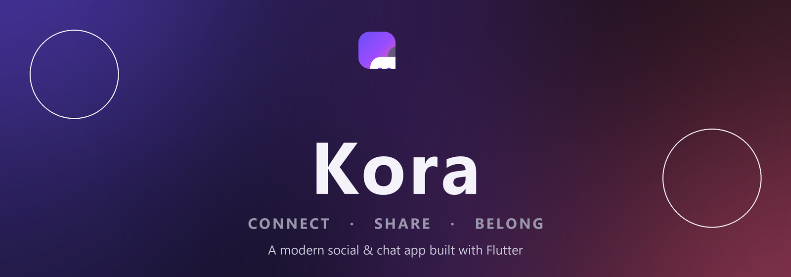
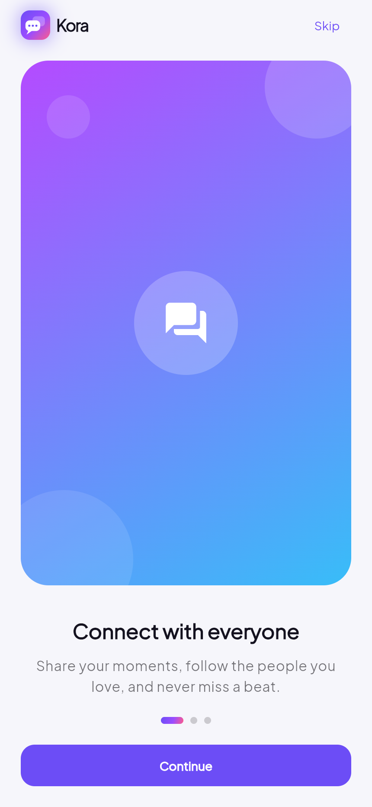
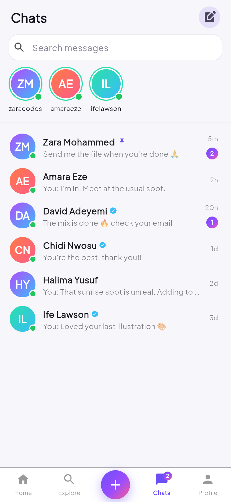
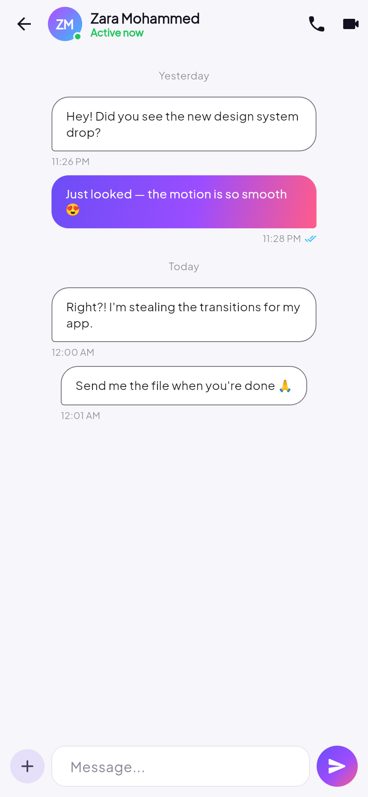
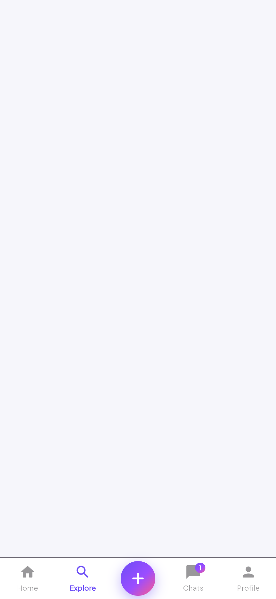
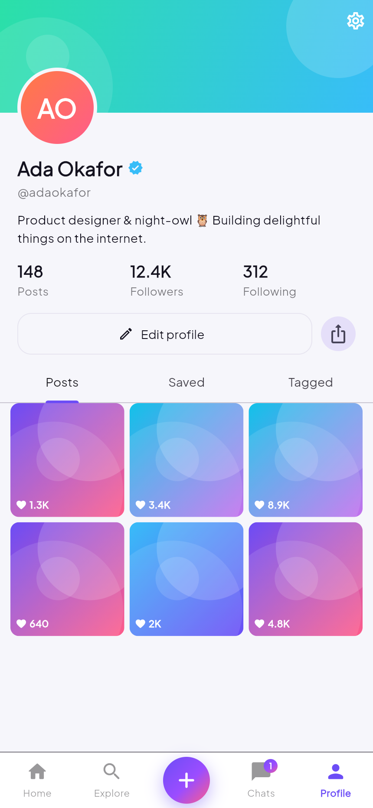
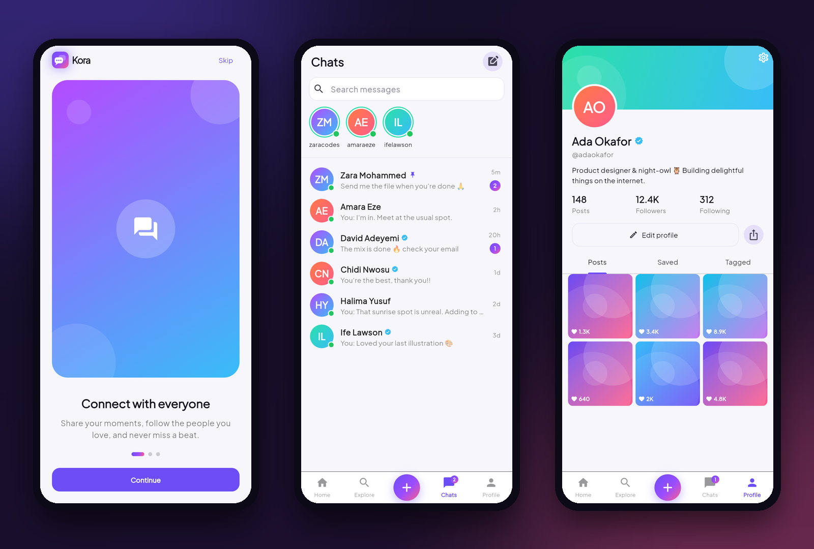

<p align="center">
  
</p>

<p align="center">
  <a href="https://flutter.dev"></a>
  <a href="https://dart.dev"></a>
  
  <a href="LICENSE"></a>
  
</p>

<h1 align="center">Kora</h1>

<p align="center">
  <b>A modern social &amp; chat app built with Flutter.</b><br/>
  A story-driven feed, expressive chat, rich profiles and a hand-crafted design system —
  all running on clean, dependency-light Flutter with an offline mock backend.
</p>

---

## ✨ Overview

**Kora** is a complete, production-shaped Flutter application built screen by screen:
from an animated splash to a full social experience with light & dark theming.
Every avatar and photo is generated at runtime, so the app needs **no image assets,
no backend, and no setup** — just `flutter run`.

## 📸 Screens

<p align="center">
  
  &nbsp;
  
  &nbsp;
  
  &nbsp;
  
  &nbsp;
  
</p>

<p align="center"><i>Feed &nbsp;·&nbsp; Chats &nbsp;·&nbsp; Conversation &nbsp;·&nbsp; Explore &nbsp;·&nbsp; Profile</i></p>

<p align="center">
  
</p>

## 🚀 Features

| | Feature | Description |
| :--: | --- | --- |
| 🎬 | **Branded splash** | Animated logo with pulsing rings, drawn with a `CustomPainter`. |
| 🧭 | **Onboarding** | Three illustrated slides with animated page indicators. |
| 🔐 | **Auth** | Login & sign-up with validation, password visibility and social buttons. |
| 📰 | **Stories & feed** | Stories bar with a full-screen viewer (segmented progress, tap to navigate, auto-advance) and rich post cards. |
| ❤️ | **Interactions** | Double-tap to like with a heart burst, comments, save, share and follow. |
| 🔎 | **Explore** | People / tag / post search, trending tags, follow suggestions and an explore grid. |
| 💬 | **Chats** | Conversation list with unread badges, "active now" row, message bubbles with delivery & read receipts, and a simulated auto-reply. |
| 👤 | **Profiles** | Animated cover + avatar, stats, edit profile and Posts / Saved / Tagged tabs. |
| 🔔 | **Activity** | Notification feed with typed icons and read / unread state. |
| ⚙️ | **Settings** | Light / dark theme toggle, account and support sections. |
| 🌗 | **Theming** | Material 3, light & dark, with a custom colour `ThemeExtension`. |

## 🏗️ Architecture

```
lib/
├── main.dart                  # entry point
├── app.dart                   # MaterialApp, routes, providers
├── core/
│   ├── branding/              # KoraLogo (CustomPainter) + wordmark
│   ├── theme/                 # colours, Material 3 theme, ThemeExtension
│   └── utils/                 # relative-time & number formatters
├── data/
│   ├── models/                # AppUser, Post, Story, ChatThread, Message, ...
│   └── mock_data.dart         # seed content (no backend needed)
├── state/
│   ├── app_state.dart         # ChangeNotifier app store
│   └── theme_controller.dart  # light/dark controller
├── widgets/                   # GradientAvatar, GradientArt, PostGrid, ...
└── features/
    ├── splash/  onboarding/  auth/
    ├── shell/                 # bottom-nav shell + create-post sheet
    ├── feed/                  # feed, story viewer, post detail, post card
    ├── search/                # explore
    ├── chats/                 # list + conversation
    ├── profile/               # profile, edit profile, settings
    └── notifications/
```

**State management:** [`provider`](https://pub.dev/packages/provider) with a single
`AppState` `ChangeNotifier`. All data is seeded in-memory, so the app runs with zero
setup and no backend.

## 🛠️ Getting started

```bash
# 1. Get dependencies
flutter pub get

# 2. Run (Web, an emulator, or a physical device)
flutter run

# Optional
flutter test        # run the tests
flutter analyze     # check for issues
flutter build web   # release web build
```

> Requires **Flutter 3.41+ / Dart 3.11+**.

## 🎨 Design system

<p align="center">
  
  &nbsp;&nbsp;&nbsp;
  
</p>

- **Brand gradient** — `#6C4DF6 → #FF5C8A` (violet → pink)
- **Accent** — `#2BE0A8` (mint)
- **Typeface** — Plus Jakarta Sans (via `google_fonts`)
- **Shape** — soft 16–28px radii, generous whitespace

## 🛠️ Built with

- **Flutter** & **Dart**
- [`provider`](https://pub.dev/packages/provider) — state management
- [`google_fonts`](https://pub.dev/packages/google_fonts) — typography
- Hand-authored `CustomPainter`s for the logo and media placeholders

## 📄 License

Released under the **MIT License** — see [LICENSE](LICENSE).

<p align="center"><sub>Made with Flutter 💙</sub></p>
